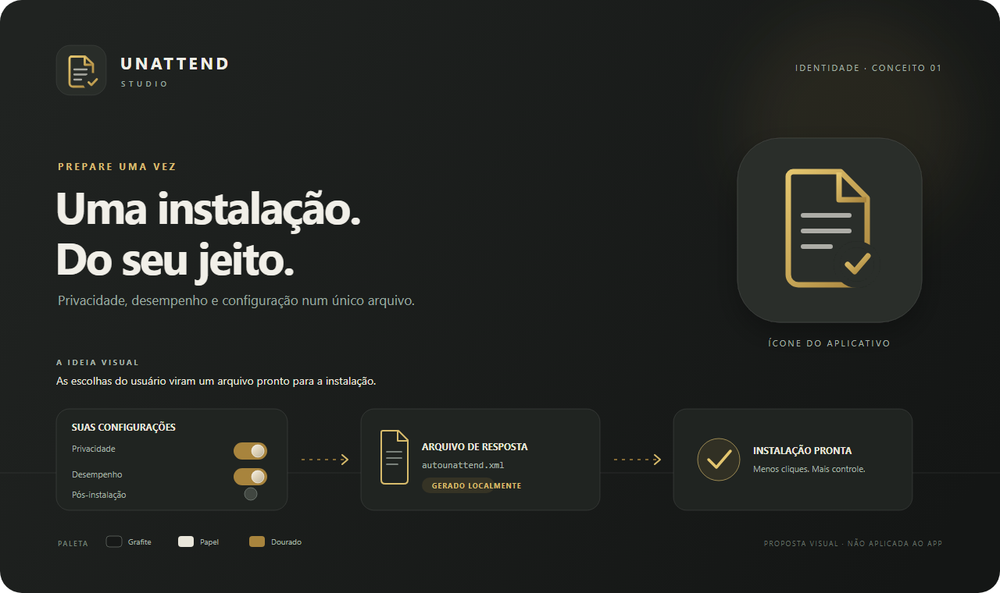

# Unattend Studio

O **Unattend Studio** é um aplicativo para Windows que ajuda a preparar um arquivo `autounattend.xml` para instalações do Windows 10 e 11. Ele reúne em uma interface visual opções que normalmente exigiriam editar XML e scripts à mão.

A configuração e a geração dos arquivos acontecem localmente. O aplicativo não precisa de internet para montar ou visualizar o XML. A conexão só é necessária quando você escolhe recursos que dependem dela, como baixar atualizações durante o Setup ou instalar programas com o WinGet depois do primeiro login.

## O que você pode configurar

- **Sistema:** versão e edição do Windows, idioma, teclado, fuso horário, nome do computador, conta local e chave de ativação opcional.
- **Instalação:** telas comuns do OOBE e Dynamic Update.
- **Formatação automática:** escolha do disco de destino e particionamento UEFI em NTFS.
- **Privacidade, desempenho e interface:** ajustes selecionáveis para reduzir coleta opcional de dados, personalizar o Windows e ajustar serviços, tarefas e comportamento do sistema.
- **Apps e IA:** seleção de pacotes integrados a remover após o primeiro login.
- **Pós-instalação:** criação de um script para instalar programas populares via WinGet, executar ajustes selecionados e, se configurado, remover o próprio script ao terminar.
- **Presets e perfis:** comece com uma configuração pronta ou salve e carregue as suas escolhas.
- **Prévia:** confira o XML e o script PowerShell antes de salvar.

A interface oferece português do Brasil, inglês e espanhol, além de temas claro e escuro.

## Como usar

1. Baixe o pacote para Windows na seção [Releases](https://github.com/ropcastr/unattend-studio/releases) e extraia todos os arquivos para uma pasta.
2. Abra `AutoUnattendStudio.exe`.
3. Escolha um preset ou configure cada seção. As opções são gravadas em um arquivo de resposta local; a prévia permite revisar o XML e o script gerado.
4. Antes de salvar, confira os avisos e confirme que as escolhas correspondem ao computador e à mídia de instalação.
5. Salve o `autounattend.xml` e coloque-o na raiz da mídia de instalação do Windows. Se você ativou o script de pós-instalação, siga a orientação mostrada pelo aplicativo para deixá-lo disponível no primeiro login.

## Atenção antes de instalar

- A opção **Apagar o disco e particionar para UEFI** apaga todas as partições e os dados do disco selecionado. Confira o número do disco com cuidado e mantenha uma cópia de segurança.
- Senhas de conta e chaves de ativação são gravadas nos arquivos gerados em formato legível ou codificado, mas **não criptografado**. Proteja o XML e o script e apague-os quando não precisar mais deles.
- A instalação de programas via WinGet exige internet e depende da disponibilidade dos pacotes no catálogo do WinGet.
- Ajustes de sistema e remoção de aplicativos executados no primeiro login podem exigir uma conta de administrador. Alguns pacotes removidos não podem ser restaurados automaticamente.
- Revise as prévias antes de usar o arquivo em um computador que contenha dados importantes. O comportamento também depende da edição, versão e mídia do Windows.

## Desenvolvido por

**Rodrigo** · [@ropcastr](https://github.com/ropcastr)

Atribuição do autor incluída nos metadados do aplicativo.
